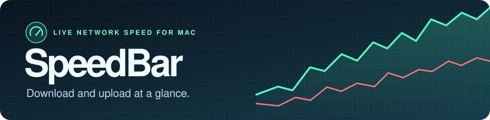
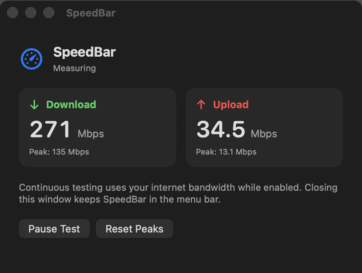
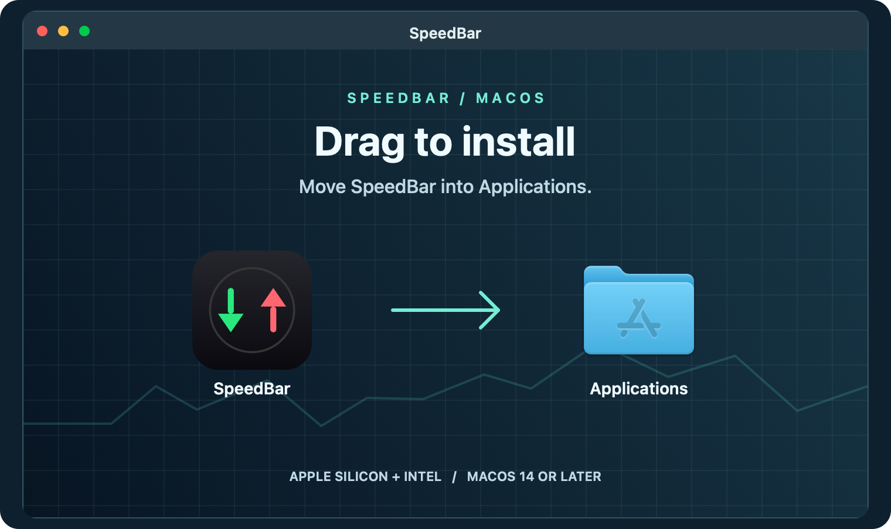
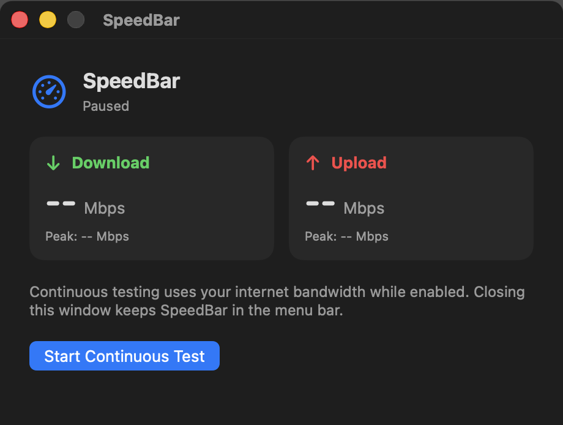

<p align="center">
  
</p>

<p align="center">
  <a href="https://github.com/timurabi3/macos-speedtest-menubar/releases/latest/download/SpeedBar.dmg"></a>
</p>

<p align="center">
  macOS 14 or later · Apple Silicon and Intel · <a href="https://github.com/timurabi3/macos-speedtest-menubar/releases/latest">Release notes and checksum</a>
</p>
<h1 align="center">Your internet speed, right in the menu bar</h1>

<p align="center">
  Watch download and upload speeds change in real time. Open the dashboard from the Dock or Spotlight to see your current speeds and session peaks.
</p>


## See SpeedBar in action



SpeedBar keeps testing when you close the dashboard. Green shows download speed and red shows upload speed.


[Watch the dashboard recording as MP4](media/dashboard-live.mp4)

## Install SpeedBar

### 1. Download and open the disk image

Click the download button above, then double-click **SpeedBar.dmg** in Downloads.


### 2. Drag SpeedBar into Applications

In the window that opens, drag the **SpeedBar** icon onto **Applications**. Eject the disk image once the copy finishes.



### 3. Open SpeedBar and start measuring

Press **⌘ Space**, search for **SpeedBar**, and press **Return**. In the dashboard, click **Start Continuous Test**. To pin it, Control-click its Dock icon and choose **Options → Keep in Dock**.



If macOS blocks the first launch, open **System Settings → Privacy & Security** and choose **Open Anyway** after attempting to open SpeedBar. This release is ad-hoc signed and has no Apple notarization. [Apple’s first-launch instructions](https://support.apple.com/en-us/102445)

## How continuous testing works

SpeedBar generates test traffic while measurement is on, so the readings keep changing even when you aren't browsing. This uses bandwidth on your connection. Choose **Pause Test** to stop traffic or **Quit SpeedBar** to close the app and its probe. You can reopen the dashboard from the menu bar or Dock.

<details>
<summary>Upgrading from a version that installed background agents</summary>

Stop the older agents once so you only have one speed test running.

```bash
for label in com.timur.speedtestmenubar com.timur.speedtestliveprobe; do
  launchctl disable "gui/$(id -u)/$label"
  launchctl bootout "gui/$(id -u)/$label" 2>/dev/null || true
done
```

</details>

<details>
<summary>Build from source</summary>

Use macOS 14+, the Xcode command-line tools with Swift 5.9+, and Go 1.22+.

```bash
go -C LiveProbe test ./...
SpeedtestMenuBarApp/Scripts/package_app.sh
```

The resulting universal app is at `SpeedtestMenuBarApp/build/SpeedBar.app`. To build and install to `~/Applications` in one step, run `./install.sh`.

For the styled disk image, install [uv](https://docs.astral.sh/uv/) and run `SpeedtestMenuBarApp/Scripts/package_dmg.sh`. It writes `SpeedBar.dmg` and `SpeedBar.dmg.sha256` to the same build directory. For a notarized build, provide a Developer ID Application identity via `SPEEDBAR_SIGN_IDENTITY` and an existing `notarytool` keychain profile via `SPEEDBAR_NOTARY_PROFILE`.

The app launches the bundled Go probe as a child process and reads a private, per-session JSON file. The probe uses a rolling 500 ms window and updates that file every 200 ms. The probe stops when its input pipe closes, including when the app is force quit. The default endpoints are CacheFly for download and Cloudflare for upload. The process environment can override them with `SPEEDTEST_LIVE_DOWNLOAD_URL` and `SPEEDTEST_LIVE_UPLOAD_URL`.

</details>

All rights reserved.
